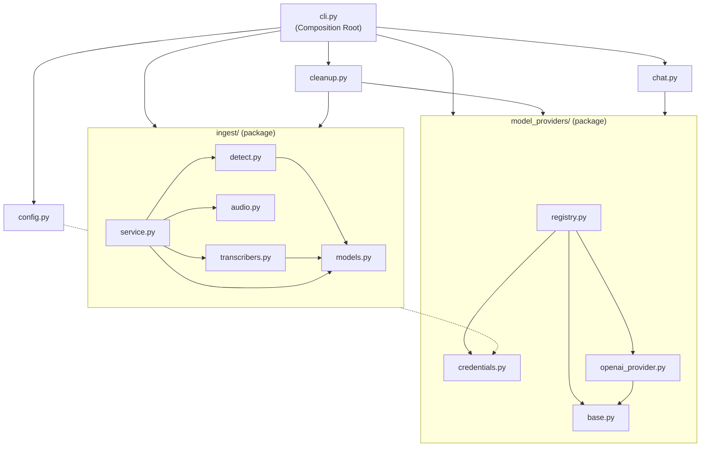
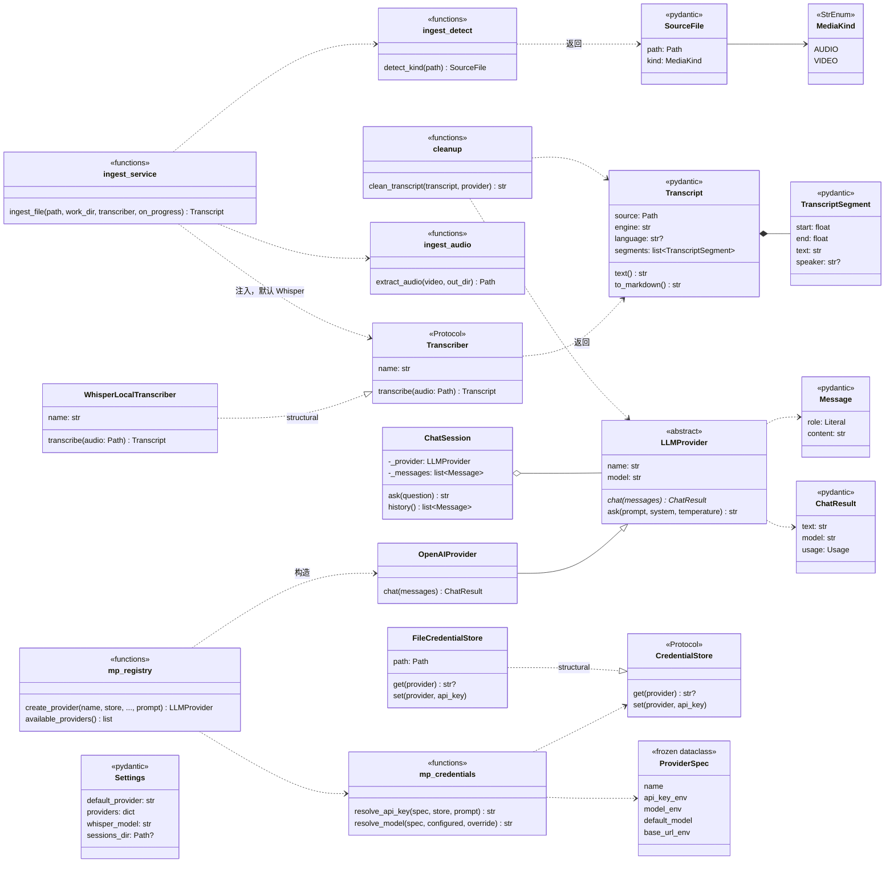
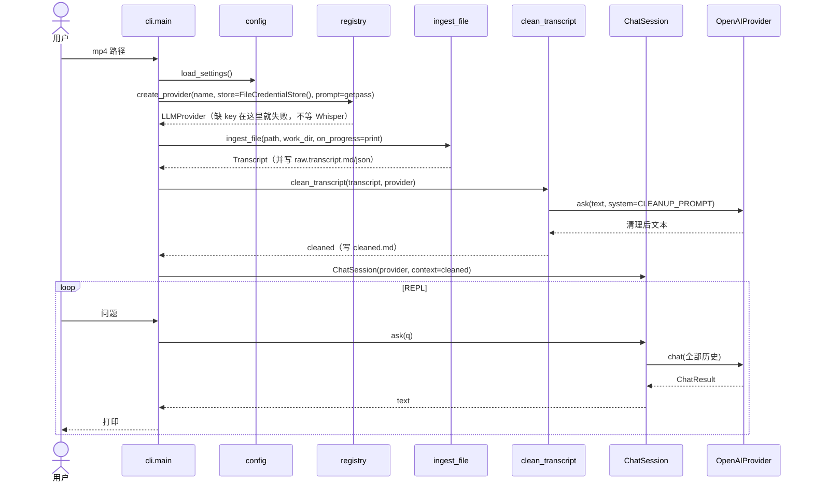

# coachagent 架构图

> 2026-10-12 根据 `coachagent/` 实际代码手工整理（cli.py 尚未实现，按骨架画）。
> 渲染：GitHub 原生支持；VS Code 装扩展 **Markdown Preview Mermaid Support**（`bierner.markdown-mermaid`）后 `Ctrl+Shift+V`。
> 自动生成的对照版见 §4。

**读图约定（C# 视角）：**
- `<<functions>>` 框 = 一个 .py 文件里的顶层函数，**≈ C# 的 static class**。Python 不强制把函数塞进类，这正是"零碎感"的来源——把每个文件当成一个 static class 看就顺了。
- 实线三角 `--|>` = 显式继承（`class OpenAIProvider(LLMProvider)`）。
- **虚线三角 `..|>` = Protocol 的结构化实现**：代码里**没有**继承关系，只是方法签名对上了。IDE 和 pyreverse 都看不见这条线，只有这张手工图有。

---

## 1. 模块依赖（谁 import 谁）



**规则**：`config`、`ingest`、`model_providers` 三个叶子互不 import；只有 `cli` 知道全部。
C# 里这由 project reference 在编译期保证；Python 没有这层保护——§5 的 `import-linter` 可以补上。

---

## 2. 类与函数



---

## 3. 运行时序（cli 一次完整运行）



---

## 4. 自动生成（随代码更新）

手工图会过时；需要"现在代码真实长什么样"时，用 **pyreverse**（pylint 自带），`uvx` 临时拉起，**不进项目依赖**：

```powershell
cd C:\Users\qli\Documents\Playground\meeting-intelligence-pipeline
uvx --from pylint pyreverse -o mmd -p coachagent -d outputs\architecture --ignore=transcribe.py,hello.py,client.py coachagent
# 产出 outputs\architecture\classes_coachagent.mmd 和 packages_coachagent.mmd
```

已验证可跑。**它看不见的东西**（这也是 §2 手工图存在的理由）：
- Protocol 的结构化实现（`WhisperLocalTranscriber ⇢ Transcriber`、`FileCredentialStore ⇢ CredentialStore`）
- 顶层函数（`ingest_file`、`create_provider` 全都不出现）
- 函数内部的 lazy import

---

## 5. 让结构"被强制"而不只是"被画出来"

**✅ 已加（2026-10-12）：`import-linter`**，契约写在 `pyproject.toml` 的 `[tool.importlinter]`：

1. **layers**：`cli` > `cleanup | chat` > `ingest | model_providers | config`——上层可 import 下层，反之不行；同层互不 import。
2. **forbidden**：`ingest` 不得 import `openai` / `google`（预处理模块与 AI 无关）。
3. **forbidden**：`model_providers` 不得 import `whisper`。

```powershell
uv run lint-imports      # 需先 uv add --dev import-linter；没加之前用：uvx --from import-linter lint-imports
```
违规时输出精确到行，例如 `coachagent.ingest.detect -> coachagent.config (l.42)`。函数内的 lazy import 同样会被抓。
新增模块（如 B3 的 `tools/`）时，记得把它放进 layers 的合适层级。

| 其他手段 | 作用 | C# 对应 |
|---|---|---|
| 显式继承 Protocol | `class WhisperLocalTranscriber(Transcriber):` —— Python 允许，语义不变，但关系变成显式的，IDE 和 pyreverse 都能看到 | `: ITranscriber` |
| VS Code / Pylance | `Ctrl+Shift+O` 文件大纲；`F12` 定义；`Shift+F12` 引用；`Ctrl+F12` 实现（只认显式继承）；`Shift+Alt+H` call hierarchy | VS 的同名功能 |
